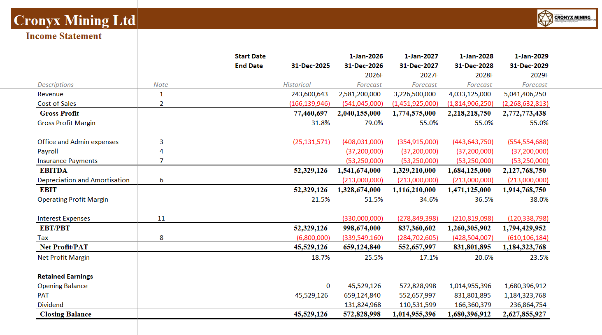
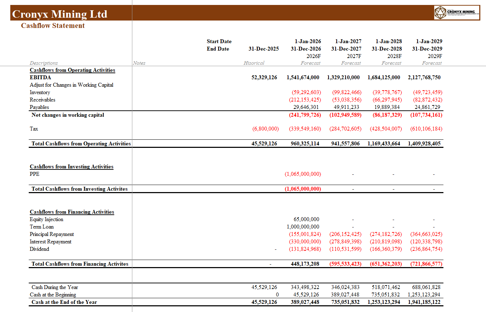

# Cronyx Mining LTD 3-Statement Financial Model
This project presents an Excel-based three-statement financial model developed for Cronyx Mining Ltd., a hypothetical mining company operating in Nigeria. The model forecasts the company's financial performance and position over a four-year period, from 2026 to 2029, using operational assumptions and financial projections.

The model integrates the Income Statement, Statement of Financial Position, and Cash Flow Statement to demonstrate how operational activities, profitability, working capital, capital expenditure, and financing decisions affect the company's overall financial performance and cash position.

**Project purpose**: Learning and demonstration of financial modelling skills.

---

## Objectives
- Develop an integrated three-statement financial model.
- Translate operational assumptions into revenue and cost projections.
- Forecast profitability, assets, liabilities, equity, and cash flows.
- Demonstrate financial modelling best practices, including formula-driven calculations, linked financial statements, and balance sheet checks.

---

## Key Modelling Components

## 1. Revenue Forecasting

## 3. Integrated Three Statement Modelling
The three financial statements are linked through formulas to demonstrate the flow of financial information across the model.
- **Income Statement**: Calculates profitability and retained earnings.

- **Statement of Financial Position**: Reflects projected assets, liabilities, and shareholders' equity.
_Preview_JohnEzugworie.png)

- **Cash Flow Statement**: Reconciles cash movements from operating, investing, and financing activities to derive closing cash balances.

